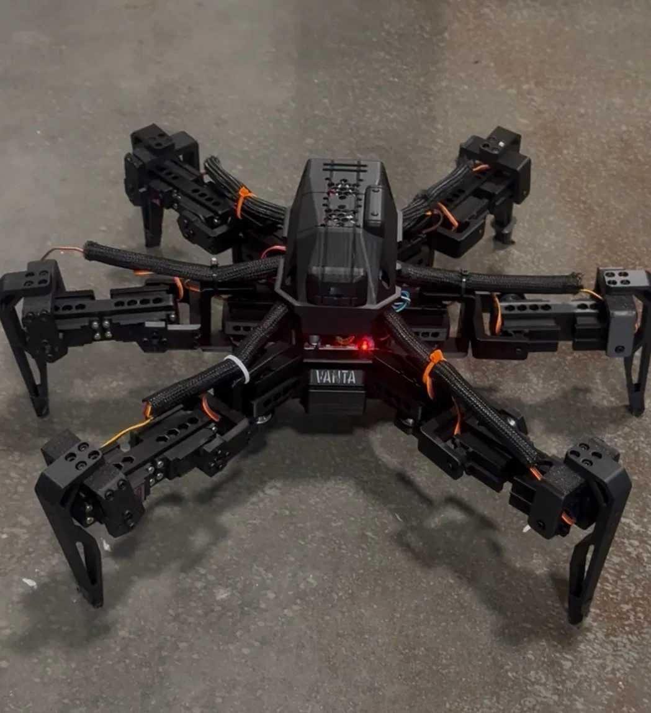
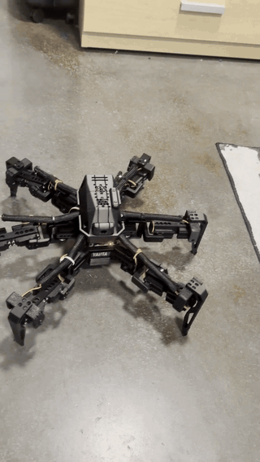
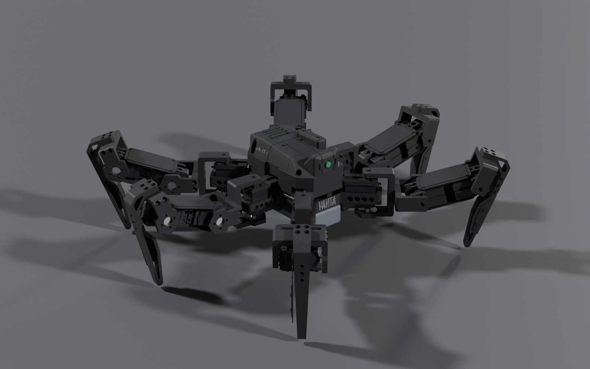
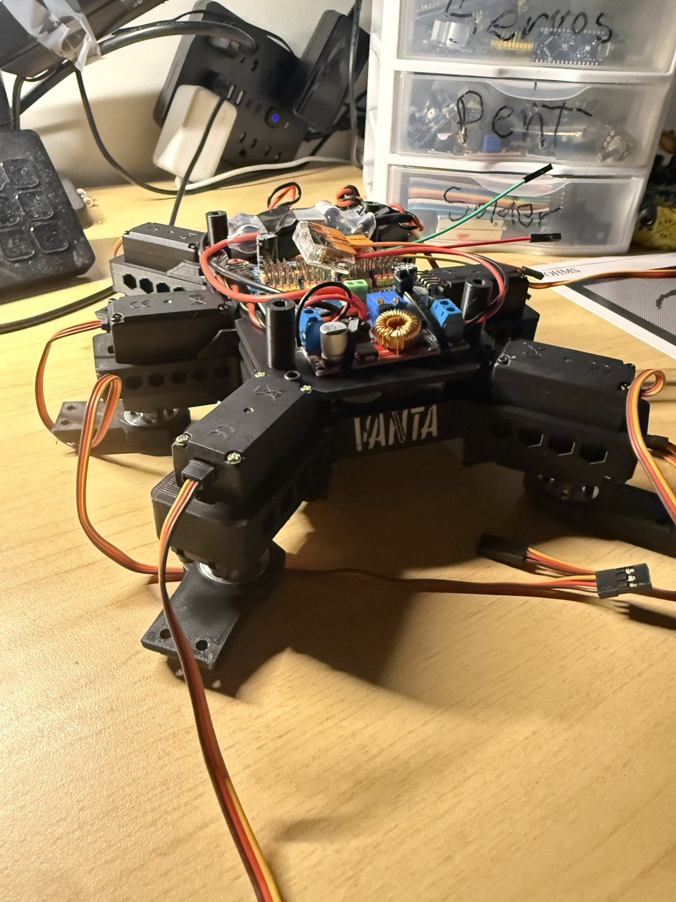
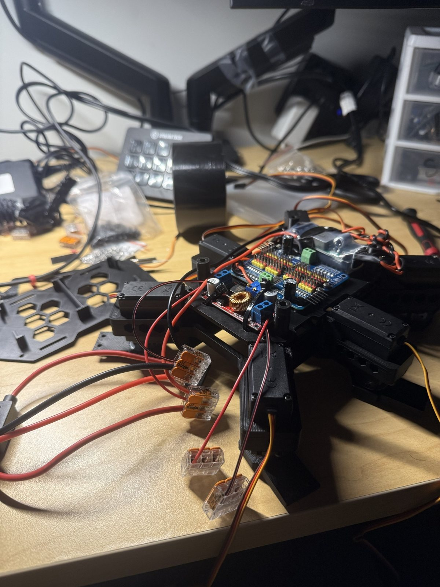

# VANTA hexapod

VANTA is my 18-DOF six-legged walking robot: 6 legs with 3 MG995 servos each, printed in PLA on a Bambu A1, wired with Wago connectors and screw terminals so nothing needs soldering. It runs on an ESP32-S3 with two PCA9685 servo drivers and I drive it with an Xbox Wireless controller over Bluetooth (Bluepad32). I designed the servo caps, aluminium-horn brackets, electronics plate, hulls, top deck, riser and camera holder, and wrote the firmware, the MuJoCo simulator, the leg neural network and the assembly guide. The leg and body parts are adapted from an open-source hexapod and reworked for this build (see Credits).

Built by Gio ([Built-By-Gio](https://github.com/Built-By-Gio)).

*VANTA walking and turning on a concrete floor.* [Watch the full walking video (1:55)](media/vanta_walking.mp4)

*The v6 CAD design (Pi-era hull).*

## Status (2026-11-25)

**Done**
- VANTA is fully built and walks on the ESP32-S3 + 2x PCA9685 build, driven from an Xbox controller over Bluetooth.
- Everything in the firmware runs on the robot: tripod walking, turning, crab walking, stand/sit, body lean, height and speed control, and the wave, bow, rear-up and dance moves.
- The learned walk, the injured-leg (5-leg) walks and step climbing run on the robot. I train and develop them in the MuJoCo simulator (`4_SOFTWARE/sim_and_training/`). Full house stairs (about 18 cm) are out of reach.
- The leg neural network (`ik_net.h`) runs on the robot. On 50,000 unseen foot positions, `train_ik.py` reports about 0.5 degrees average joint error.
- The Fusion top deck, riser, camera holder and slotted tall hull (`3_CAD/deck_hull_fusion/`) are printed and on the robot.

**Not done yet**
- Camera: the holder is on the robot (Waveshare ESP32-S3-CAM, OV5640). The camera code is not written yet.
- Carrier PCB (`6_PCB_CARRIER/`): design only, not ordered. It targets the old Raspberry Pi layout.
- Raspberry Pi software (`4_SOFTWARE/hexapod-brain/`): legacy. VANTA started on a Raspberry Pi 4, and I replaced it with the ESP32-S3 before this code ran on the robot.

**Known problems**
- MG995 servos have overheated and failed: one died on the bench and was swapped. Keep a spare or two.
- The assembly guide's pictures show the +1 servo cap; the cap that fits is +2 (1 mm difference, cosmetic).
- `1_PRINT/VANTA_print_MAIN_A1.3mf` was rewritten by a script to 12 plates with +2 caps and has not been re-opened in Bambu Studio since. Check the plates before printing.
- Check the deck fit before printing the files in `3_CAD/deck_hull_fusion/`: the riser columns reach Z 59.9 mm and run 3.2 mm into the deck, and the riser opening covers the end-header servo plugs by 0.5 mm.
- Measure your camera module; the camera holder assumes a module depth of 8.5 mm.
- `3_CAD/VANTA_standing.glb` still shows an older bracket B, horn and caps. The CAD render near the top shows the v6 CAD design with the Pi-era hull, not the robot as it is today.

**Battery:** the robot runs on a 3S LiPo (stop at 10.5 V). The original parts list named a Zeee 2S 5200 mAh XT60 pack. Check that your SBEC and buck converter accept your pack's voltage.

**Still to add**
- How the ESP32-S3 board is mounted and fed 5 V (its ground goes to the 5 V- Wago).
- The script that exports `walk_net.h` (`export_walk.py`), and a note on what `best.npy` holds.

The 5:54 assembly video rendered from the CAD (337 MB) is not in this repo because of its size; its source pipeline is in `7_VIDEO/assembly_video_src/`.

## Photos

| | |
|---|---|
|  |  |
| Electronics plate during the build | Power wiring with Wago connectors |

## What you need

**Electronics and hardware** (from the 2026-11-03 parts list, `BUY_LIST.md`, with the controller changed to the current ESP32 build):

| Item | Qty |
|---|---|
| MG995 servo (plus spares) | 18 |
| ESP32-S3 DevKitC | 1 |
| PCA9685 16-channel servo driver | 2 |
| Xbox Wireless controller (Bluetooth) | 1 |
| 20 A SBEC set to 6.0 V (servo power) | 1 |
| XL4015 buck converter set to 5.1 V (logic, fans) | 1 |
| LiPo with XT60 plug (see the battery note above) | 1 |
| 20 A inline fuse, XT60 rocker switch, XT60 pigtails | 1 each |
| Wago 221 lever connectors, 16 AWG wire, F-F jumpers | as needed |
| 30 cm servo extensions | 6 |
| 30 mm 5 V fans (hull roof) | 2 |
| DaFuRui 25T aluminium disc horns (Ø20 mm, 4x M3 on a 10 mm square) | 18 |
| 623ZZ bearings (3x10x4, not flanged) | 18 |
| M3 heat-set inserts (M3 x L4 x OD5) | 44 |
| M3x6 / M3x8 / M3x10 screws | 28 (+72 for the horns) / 48 / 110 |
| M2.5x6 screws / M2x8 screws with nuts | 12 / 4 |
| Grip tape for the feet, CA glue | |

The main board and drivers need no soldering. The robot weighs about 2.45 kg with the hull (design estimate).

**Printing:** a Bambu A1 (the 3MF files are set up for it), black PLA, and optionally silver PLA with an AMS for the lettering.

**Software:**
- Arduino IDE 2 with the `esp32_bluepad32` board package 4.1.0 (board manager URL: `https://raw.githubusercontent.com/ricardoquesada/esp32-arduino-lib-builder/master/bluepad32_files/package_esp32_bluepad32_index.json`). Bluepad32 comes with this board package.
- Arduino libraries: Adafruit PWM Servo Driver Library 3.0.3 and Adafruit BusIO 1.17.4.
- For the simulator and training: Python 3.13 with `mujoco` (tested with 4.0.0) and `numpy` (tested with 2.5.3).

## How to build / run

1. **Print the fit test first.** Open `1_PRINT/VANTA_print_MAIN_A1.3mf` and print plate 1: one bracket A, one bracket B and one +2 servo cap. Build one joint (guide step 1) and check the cap fits your servo. Cap STLs from +0 to +3 are in `1_PRINT/stl_main/` if yours needs a different size.
2. **Print the rest of the MAIN file.** `1_PRINT/MAIN_plate_layout.png` shows all 12 plates. Infill: femur, tibia, both bracket As, bracket B and the caps at 15% with 4 walls; electronics plate, deck and battery mount at 10% with 2 walls; armour at 5% (it is cosmetic). The hull (`1_PRINT/VANTA_print_COLOR_AMS_A1.3mf`, or a variant from `3_CAD/deck_hull_fusion/deck_out/`) prints upright with tree supports at 10%.
3. **Assemble the mechanics** with `VANTA_assembly_guide.pdf` (rev 9, 33 pages). Each joint: a slip-on cap holds a 623ZZ bearing; an M3x10 axle self-taps through bracket A into the bearing; on the horn side, bracket B sits over the aluminium disc with 4x M3x6. Self-tap holes: drive the screw in once to cut the thread, back it out, then assemble. Wrap grip tape around the bottom 25 mm of each tibia tip as the foot. The guide's Pi wiring and Pi software chapters are legacy; use steps 4 to 8 below for the electronics.
4. **Wire the power.** Battery, switch, 20 A fuse, then a BATT+ Wago that feeds the SBEC and the buck. Both SBEC outputs (6.0 V) go to the green V+ terminals of both PCA9685 boards. The buck output (5.1 V) goes to the 5V+/5V- Wagos. PCA9685 VCC comes from the ESP32's 3.3 V. Never put servo power on a board's 5 V pin.
5. **Wire the drivers to the ESP32-S3.** Driver 1 on `Wire`: SDA GPIO 8, SCL GPIO 9. Driver 2 on `Wire1`: SDA GPIO 4, SCL GPIO 5. Both stay at address 0x40. Plug the servos in as in the table below (`BOARD`/`CH` in `vanta_hexapod_pad.ino`, lines 39-41). Leg names are from the robot's point of view, front = the way it walks with the stick forward.

   | Leg | coxa | femur | tibia |
   |---|---|---|---|
   | front left | driver 2 ch 0 | driver 2 ch 1 | driver 2 ch 2 |
   | middle left | driver 2 ch 4 | driver 2 ch 5 | driver 2 ch 3 |
   | back left | driver 2 ch 7 | driver 2 ch 6 | driver 2 ch 8 |
   | front right | driver 1 ch 0 | driver 1 ch 1 | driver 2 ch 15 |
   | middle right | driver 1 ch 3 | driver 1 ch 4 | driver 1 ch 5 |
   | back right | driver 1 ch 6 | driver 1 ch 7 | driver 1 ch 8 |

   If your wiring differs, edit `BOARD` and `CH`.
6. **Check every servo before walking.** In the Arduino IDE pick board "ESP32S3 Dev Module" and enable "USB CDC On Boot". Upload `5_ELECTRONICS_TEST/esp32s3/servo_finder/servo_finder.ino` to see which channel each servo is on (Serial Monitor 115200, "No line ending"; type `2 6` to wiggle driver 2 channel 6). Then upload `5_ELECTRONICS_TEST/esp32s3/servo_check/servo_check.ino`, which wiggles all 18 joints in order using the same table (`n` next, `b` back, `r` repeat). If the Serial Monitor shows only `ESP-ROM:`, press RST.
7. **Upload the walking firmware.** Open `4_SOFTWARE/esp32_firmware/vanta_hexapod_pad/vanta_hexapod_pad.ino` (keep `ik_net.h` and `walk_net.h` in the same folder) and upload it. Put the robot down sitting: battery on the floor, legs spread in a standing shape.
8. **Calibrate the stand pose.** In the Serial Monitor (115200, "No line ending"): `1`-`6` pick a leg, `c`/`f`/`t` pick a joint, `+`/`-` nudge 10 µs, `]`/`[` nudge 50 µs, `n` flips a joint's direction, `p` prints the `HOME_US` and `SIGN` arrays. Paste them into the sketch and upload again.
9. **Pair the controller and drive.** Put the Xbox controller in pairing mode; the ESP32 connects through Bluepad32 (`z` in the Serial Monitor forgets paired controllers). R2 stands up, L2 sits down and powers off, the Menu button turns every servo off at once. Left stick walks and crabs, right stick turns. The full control list (moves, height, speed, climb mode, injured leg, learned walk) is in the comment at the top of the sketch.

**Simulator and training** (`4_SOFTWARE/sim_and_training/`):
1. `pip install mujoco numpy`
2. `python vanta_sim.py fast` trains a population of simulated VANTAs with no window and saves the best brain to `vanta_brain.npy` in the current folder; `python vanta_sim.py` trains with a viewer; `python vanta_sim.py watch` replays the saved brain. Add a leg name (`FL ML RL FR MR RR`) to train a 5-legged walk, e.g. `python vanta_sim.py RL fast`. `vanta_brain_no_RL.npy` is a saved brain trained without the rear-left leg. The `meshes/` folder must stay next to the script.
3. `python train_ik.py` trains the leg network and writes `ik_net.h`; copy it into the firmware folder.

**CAD:** the Fusion deck script `3_CAD/deck_hull_fusion/vanta_deck_fusion.py` runs inside Fusion 360's script environment (`adsk` API). The generator scripts in `3_CAD/source/` (CadQuery/trimesh/Blender `bpy`) and `7_VIDEO/assembly_video_src/` are kept as reference for how the parts, print files and video were made. They expect a working folder layout that is not in this repo, so their paths need adjusting before they run.

## Repo layout

| Folder | What is in it |
|---|---|
| `VANTA_assembly_guide.pdf` | Assembly guide rev 9 (33 pages). Mechanical steps are current; the Pi wiring and software chapters are legacy. |
| `BUY_LIST.md` | Parts status as of 2026-11-03 (Pi-era; the controller is now the ESP32-S3). |
| `1_PRINT/` | `VANTA_print_MAIN_A1.3mf` (12 plates, +2 caps) and `MAIN_plate_layout.png`; `VANTA_print_COLOR_AMS_A1.3mf` (mech hull with silver lettering, logo letters, optional AMS base); `VANTA_one_leg_A1.3mf` (one leg on one plate, older +1 caps); STLs in `stl_main/` and `stl_color_AMS/`. |
| `3_CAD/` | `VANTA_standing.glb`, `servo_cap.step`, `stl_in_place/` (every part in the URDF frame), `source/` (generator scripts, reference only, plus `hexapod.urdf`). |
| `3_CAD/deck_hull_fusion/` | Fusion-rebuilt top deck, riser, camera holder and spacers (`deck_out/`, STL + STEP), tall-hull slot variants, modelled wire routing (`wires/`: braids, servo leads, jumpers as STEP, path data), and the Fusion scripts. The deck, riser, camera holder and slotted tall hull are on the robot. |
| `4_SOFTWARE/esp32_firmware/` | Current walking firmware `vanta_hexapod_pad` (ESP32-S3, 2x PCA9685, Bluepad32) with `ik_net.h` and `walk_net.h`. |
| `4_SOFTWARE/sim_and_training/` | MuJoCo walking simulator with meshes, the leg-network trainer, and saved brain weights. |
| `4_SOFTWARE/hexapod-brain/` | Legacy Raspberry Pi 4 software (kinematics, gait, gesture control, phone page, calibration). Not used on the current robot. |
| `5_ELECTRONICS_TEST/` | Bench tools: `servo_finder` and `servo_check` for the current ESP32 build; the one-leg test sketches and a Web Serial slider page (`servo_console.html` + `servo_console` sketches) for ESP32-S3 and Arduino Uno. |
| `6_PCB_CARRIER/` | KiCad carrier board rev A: PCB, netlist, schematic PDF, STEP, Gerbers and JLC fab files. Design only, on hold, targets the old Pi layout. There is no editable schematic file, only the netlist and PDF. |
| `7_VIDEO/assembly_video_src/` | Blender + Python pipeline for the assembly video (fonts not included; see its README). |
| `renders/` | CAD renders of the v6 robot, hull, joint and parts. |
| `media/` | Photos of the built robot, `vanta_walking.mp4` (1:55 walking video) and `vanta_walking.gif` (8-second preview). |

## Roadmap / future plans

Planned:
- **Fallen-person detection:** use the ESP32-S3 camera board to stream to a phone, show person boxes and an alert, and train a "person down / waving / OK" classifier on clips filmed from floor level.
- **Search behaviour:** scan, turn and walk toward a person the camera finds.
- **IMU self-levelling** with a BNO085 (the new top deck has a pocket for it).
- **Bus servos:** replace the MG995s, which have overheated and failed, with Waveshare ST3215 bus servos.
- **Learned walks:** add steering to the learned and injured-leg walks (they go forward and back only).

## Credits and license

- Legs, base, stiffeners, battery mount and `hexapod.urdf` are adapted from [ggldnl/Hexapod-Hardware](https://github.com/ggldnl/Hexapod-Hardware) (CERN-OHL-W-2.0). `CREDITS.md` lists exactly which files are derived and what I changed.
- Hardware design files (STL, 3MF, STEP, GLB, URDF, PCB files, assembly guide): CERN-OHL-W-2.0, see `LICENSE-HARDWARE`. The full licence text is in `CERN-OHL-W-2.0.txt`.
- Firmware and software: MIT, see `LICENSE`.
- Dependencies (not included): Bluepad32, Adafruit PWM Servo Driver, MuJoCo, NumPy; the legacy Pi software also uses OpenCV, Picamera2 and MediaPipe.
